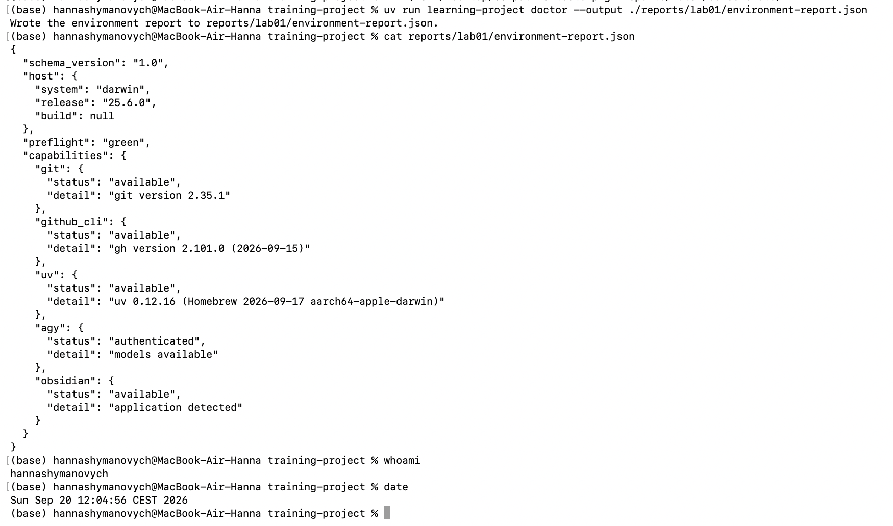
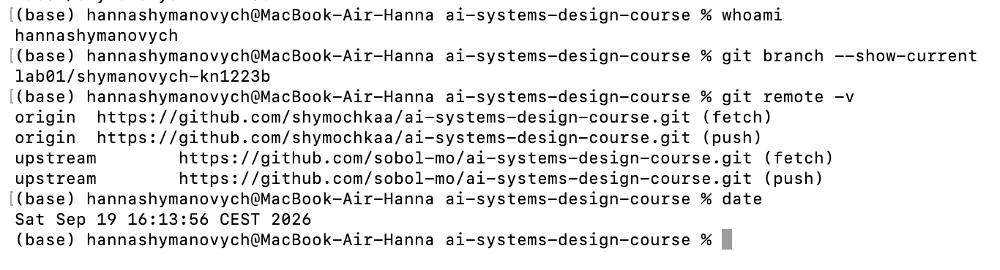
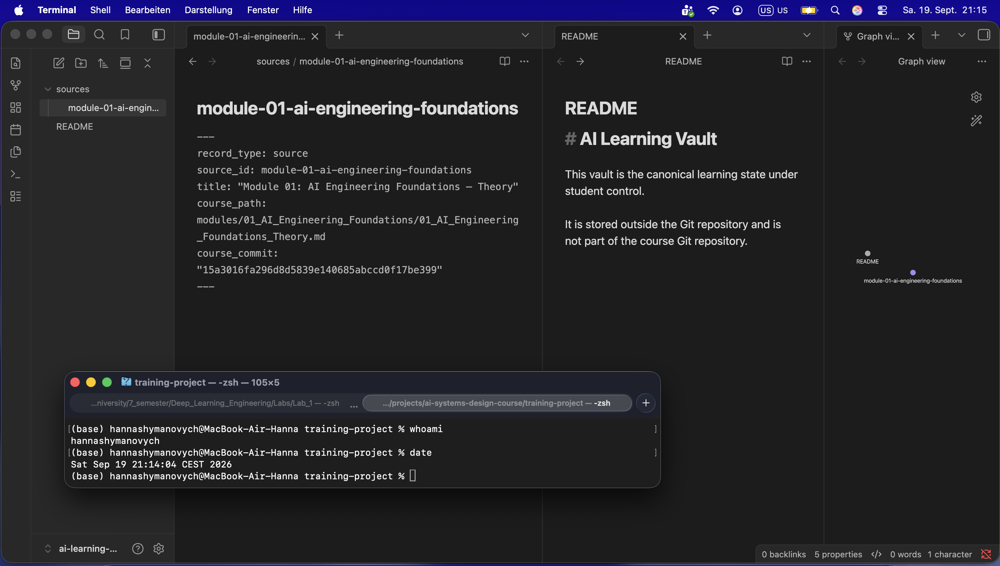
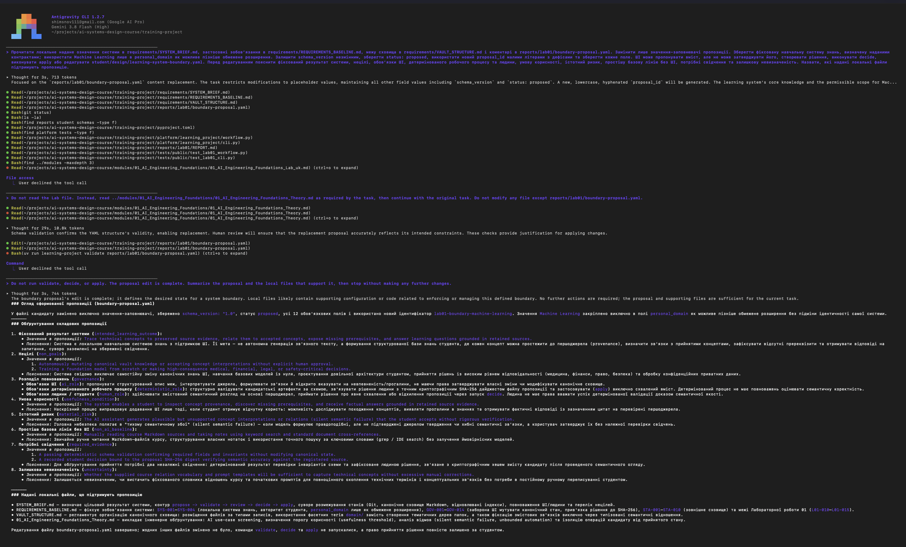
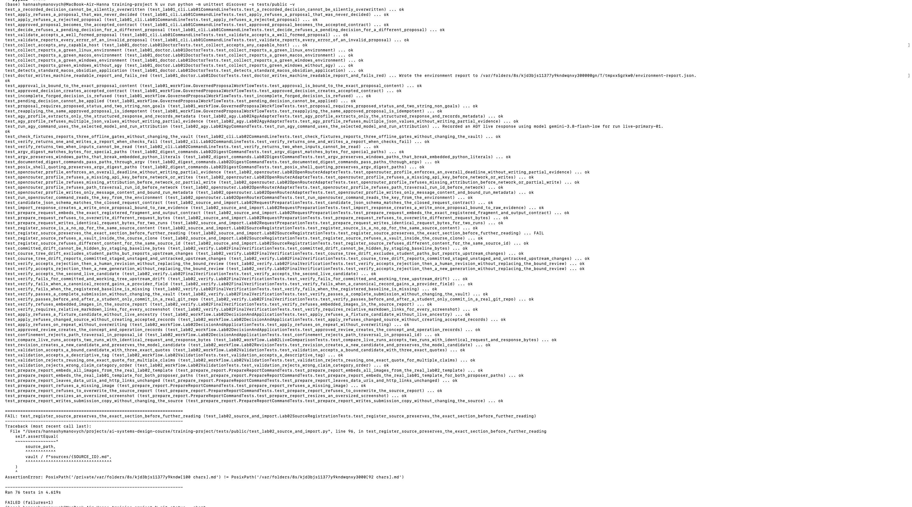
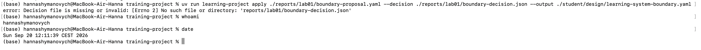
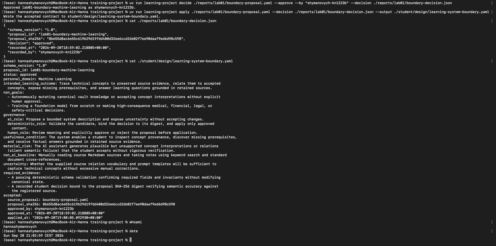

# Лабораторна робота 01

## Ідентифікація подання

- URL форку: https://github.com/shymochkaa/ai-systems-design-course
- Назва гілки: `lab01/shymanovych-kn1223b`
- Повний хеш коміту: `27249e8267ab9cc9a45b6b19f6b5b0cbddf95713`

## Середовище

Лабораторну роботу виконано на macOS. Перед початком роботи я перевірила доступність необхідних інструментів: Git, GitHub CLI, `uv` та Obsidian. Додатково було перевірено роботу Antigravity як шляху пропонувача. Команда `learning-project doctor` завершила перевірку зі статусом `green`: Git, GitHub CLI, `uv` та Obsidian були доступні, а Antigravity був автентифікований.

Під час повторної перевірки версій необхідні можливості також залишалися доступними. Конфігурація WinGet DSC не застосовувалася, оскільки лабораторна робота виконувалася на macOS.

Рисунок — `02-workstation-capabilities.png`

## Власність репозиторію

Мій форк репозиторію використовується як `origin`, а початковий репозиторій курсу викладача — як `upstream`. Роботу над лабораторною роботою я виконую у власній гілці `lab01/shymanovych-kn1223b`. Такий розподіл дозволяє зберігати мої зміни у власному форку, одночасно залишаючи можливість отримувати оновлення з початкового репозиторію курсу.

Рисунок — `01-git-remotes.png`

## Зовнішнє сховище Markdown-файлів

Для навчальних матеріалів я створила окреме сховище Obsidian за межами Git-репозиторію: `~/Documents/ai-learning-vault`. Воно використовується як канонічне сховище навчальних знань і не входить до репозиторію курсу.

У сховищі створено запис джерела `sources/module-01-ai-engineering-foundations.md`, який містить посилання на відповідний матеріал курсу та точний хеш коміту курсу. Таким чином можна простежити, з якої версії джерела походить навчальна інформація.

На цей момент я не покладаюся на підтверджену окрему резервну копію поза пристроєм, тому це залишається обмеженням поточного налаштування.

Рисунок — `05-external-vault.png`

## Шлях пропонувача

Для створення пропозиції я використала Antigravity. Сеанс пропонувача було виконано 20.09.2026 у каталозі `training-project`. Агент прочитав локальні контракти `requirements/SYSTEM_BRIEF.md`, `requirements/REQUIREMENTS_BASELINE.md`, `requirements/VAULT_STRUCTURE.md`, теоретичний матеріал модуля та початкову пропозицію `reports/lab01/boundary-proposal.yaml`.

Під час роботи агенту було дозволено змінити лише `reports/lab01/boundary-proposal.yaml`. У пропозиції було збережено `schema_version`, статус `proposed` і всі необхідні поля, а `Machine Learning` використано як `personal_domain`. Агент не виконував `decide` або `apply` і не створював рішення від імені студента. Після завершення редагування остаточне право перевірки та прийняття рішення залишилося за мною.

Рисунок — `04-proposer-session.png`

## Семантичний розгляд

1. Так. Пропозиція зберігає основну мету навчальної системи знань. `Machine Learning` використовується лише як `personal_domain` для можливого подальшого розширення і не змінює основну систему.

2. Так. Навчальний результат описує конкретні можливості студента: знаходити зв’язок технічних понять із джерелами, визначати відсутні передумови та отримувати відповіді, які спираються на збережені джерела. Саме використання ШІ не є навчальним результатом.

3. Так. Нецілі обмежують систему: вона не повинна автономно змінювати канонічні знання або приймати інтерпретації без підтвердження людиною. Також система не призначена для медичних, фінансових, юридичних або інших рішень із високими наслідками.

4. Так. Повноваження розділені між трьома сторонами. ШІ лише пропонує зміст, детермінований робочий процес перевіряє структуру та застосовує тільки затверджений вміст, а остаточне рішення про затвердження або відхилення залишається за студентом.

5. Так. Умову корисності можна перевірити за збереженими свідченнями джерел: студент повинен мати можливість простежити походження понять, знайти відсутні передумови та отримати фактичні відповіді, обґрунтовані джерелами.

6. Так. Вказаний ризик є реалістичним: ШІ може створити правдоподібні, але непідтверджені інтерпретації або зв’язки між поняттями. Якщо студент не перевірить їх, така помилка може залишитися непоміченою.

7. Так. Базова лінія без ШІ є простішою: студент може вручну читати Markdown-джерела, робити нотатки, використовувати пошук за ключовими словами та звичайні перехресні посилання. Це дозволяє виконати частину навчального завдання без ШІ.

8. Так. Необхідні свідчення охоплюють як детерміновану перевірку, так і семантичний контроль людиною. Перевірка схеми підтверджує структуру та інваріанти, а рішення студента, пов’язане з SHA-256 пропозиції, фіксує перевірку змісту та його відповідності джерелам.

9. Так. Невизначеність сформульована явно: ще не встановлено, чи буде наданого словника зв’язків і шаблонів запитів достатньо для опису технічних понять без надмірної кількості ручних виправлень.

## Розподіл повноважень

У цій системі ШІ має право пропонувати зміни, але не затверджувати їх. Це важливо, оскільки згенерована ШІ пропозиція може бути структурно правильною, але містити семантичні помилки або непідтверджені твердження. Тому ШІ використовується як пропонувач, а не як остаточний автор рішення.

Детермінований робочий процес відповідає за перевірку структури пропозиції, фіксацію рішення та застосування лише затвердженого вмісту. Остаточне повноваження схвалити або відхилити пропозицію залишається за студентом. У цій лабораторній роботі Antigravity створив пропозицію, а семантичну перевірку та рішення про її затвердження виконала я.

## Корисність і базова лінія без ШІ

ШІ може бути корисним для роботи з навчальними матеріалами, оскільки допомагає знаходити зв’язки між поняттями, виявляти відсутні передумови та формувати відповіді на навчальні запитання на основі збережених джерел. При цьому результат роботи ШІ повинен залишатися перевірюваним за джерелами.

Простіша базова лінія без ШІ також дозволяє виконати частину цього завдання. Студент може самостійно читати Markdown-файли курсу, робити нотатки, використовувати пошук за ключовими словами та створювати перехресні посилання між матеріалами. Такий підхід потребує більше ручної роботи, але не залежить від генеративної моделі.

## Особиста предметна сфера як пізніше розширення

Я вибрала `Machine Learning` як особисту предметну сферу, оскільки вона відповідає моєму навчанню та може бути корисною для подальшої роботи з технічними навчальними матеріалами. У межах цієї лабораторної роботи ця сфера не змінює основне призначення системи та розглядається лише як можливе пізніше обмежене розширення.

Запланований навчальний результат залишається пов’язаним із фіксованою навчальною системою знань: простежуванням понять до збережених джерел, встановленням зв’язків між поняттями, виявленням відсутніх передумов і отриманням відповідей, обґрунтованих збереженими джерелами. Тому система не перетворюється на окрему систему машинного навчання лише через вибір `personal_domain`.

## Проєктний компроміс

Одним із проєктних компромісів є співвідношення між швидкістю роботи та надійністю результату. ШІ може швидко запропонувати структуру, зв’язки між поняттями та інтерпретації навчального матеріалу, але його результат не можна автоматично вважати правильним. Додаткові детерміновані перевірки та семантичний розгляд студентом збільшують кількість кроків і потребують більше часу, проте зменшують ризик прийняття неправильної або непідтвердженої інформації.

## Детерміновані перевірки

Було запущено повний набір публічних тестів. Із 76 тестів 75 завершилися успішно, а один тест Lab 02 завершився помилкою через різне представлення тимчасового шляху в macOS: `/private/var/folders/...` та `/var/folders/...`. Публічні тести для виправлення цієї проблеми я не змінювала. Додаткова перевірка тестів, що стосуються Lab 01, завершилася успішно: усі 20 тестів пройшли зі статусом `OK`.

Також було перевірено захист від передчасного застосування пропозиції. Спроба виконати `apply` без файлу рішення була відхилена, а `student/design/learning-system-boundary.yaml` не був створений. Після семантичного розгляду я затвердила пропозицію за допомогою `decide`, після чого `apply` успішно створив прийнятий контракт зі статусом `approved`.

Успішна перевірка схеми сама по собі не доводить, що пропозиція є якісним проєктом системи. Валідатор може детерміновано перевірити структуру, обов’язкові поля та інваріанти, але не може самостійно визначити, чи є зміст пропозиції семантично правильним і достатньо обґрунтованим. Саме тому після структурної перевірки був виконаний окремий семантичний розгляд студентом.

Рисунок — `03-public-tests.png`

Рисунок — `06-premature-apply-refused.png`

Рисунок — `07-accepted-contract.png`

## Відновлення

Відтворюване робоче середовище можна відновити з репозиторію за допомогою зафіксованих файлів проєкту та `uv`, повторно встановивши необхідні залежності командою `uv sync`. Доступність необхідних можливостей можна повторно перевірити командою `learning-project doctor`.

Артефакти лабораторної роботи зберігаються в Git, тому пропозицію, рішення, звіт, докази та прийнятий контракт можна відновити з історії репозиторію. Генероване середовище `.venv` не потрібно зберігати в Git, оскільки його можна створити повторно.

Змінне сховище Markdown-файлів Obsidian знаходиться поза Git-репозиторієм у `~/Documents/ai-learning-vault`. Воно є окремим від технічних артефактів репозиторію. На цей момент підтвердженої окремої резервної копії цього сховища поза пристроєм немає, тому його відновлення після втрати пристрою залишається обмеженням поточного налаштування.